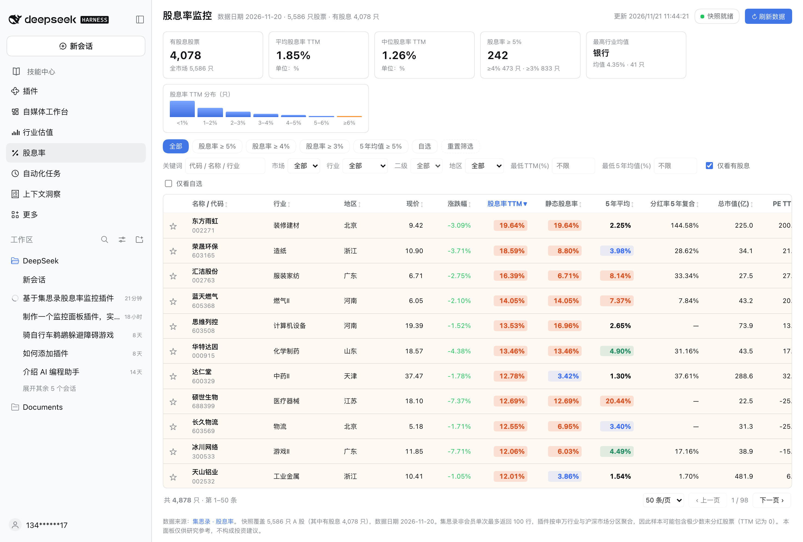

# dsh-dividend-yield · 股息率监控

DSH Web GUI 插件：把[集思录 · 股息率](https://www.jisilu.cn/data/stock/dividend_rate/)页面做成常驻侧栏的监控面板。



 

## 功能

- **全市场快照**：集思录非会员单次只返回 100 行，插件把接口按申万行业（一级→二级→三级）与沪深市场分区抓取，聚合出 5500+ 只 A 股的完整快照，落盘 `data/universe.json`，启动后自动刷新（默认 2 小时后过期、每小时检查）。
- **概览**：有股息股票数、平均 / 中位股息率 TTM、≥3/4/5% 家数、股息率分布直方图、行业均值排行。
- **筛选**：关键词（代码 / 名称 / 行业）、市场、申万一级 / 二级行业、地区、最低 TTM 股息率、最低 5 年均值、仅看自选、仅看有股息；一键预设（≥5% / ≥4% / ≥3% / 5 年均值 ≥5% / 自选）。
- **表格**：21 列可排序指标（现价、涨跌幅、TTM、静态、5 年平均、市值、PE/PB 及温度、ROE、净利同比、营收/利润复合、负债与质押），股息率按档位着色，TTM ≥ 5% 行高亮；每页 50/100/200 条。
- **自选**：星标保存到 `localStorage`，随开随用。
- **详情抽屉**：点击任意行查看完整字段（股息率、行情估值、财务、风险与分红记录）。

## 数据来源与口径

- 接口：`POST https://www.jisilu.cn/data/stock/dividend_rate_list/`（form-urlencoded）。
- `dividend_rate` = 股息率 TTM，`dividend_rate2` = 静态股息率，`dividend_rate5` = 5 年平均股息率。
- 全市场快照由约 200 次分区请求聚合而成；请求失败会自动重试，失败分区记录在 `/snapshot` 的 `failed` 字段。
- 集思录默认页显示「3,572 只满足条件」是因为默认过滤了零股息股票；本快照保留全部 5,586 只，面板默认勾选「仅看有股息」，所以默认列表与集思录口径一致。
- 面板只做数据整理，不构成投资建议。

## 安装

安装后侧栏出现「股息率」入口，点击打开面板。首次打开会在后台抓取全市场快照（网络正常约 10 秒～3 分钟，面板上显示进度），之后自动缓存与定时刷新。

> ⚠️ **安装时请填仓库地址，不要填 `dsh-dividend-yield`。**
> 这个包**没有发布到 npm**，填裸包名时插件管理器会拿它去 npm registry 查，查不到就会在输入框下方报红字「**未找到相关插件**」。
> 正确做法是填 `https://github.com/yuyiky/dsh-dividend-yield`。

### 方式一：从 GitHub 安装（推荐，别人用这个）

在 DSH 桌面端「插件」页的安装入口填入仓库地址（下面几种写法都行）：

```
https://github.com/yuyiky/dsh-dividend-yield
https://github.com/yuyiky/dsh-dividend-yield.git
github:yuyiky/dsh-dividend-yield
git+https://github.com/yuyiky/dsh-dividend-yield.git#<可选：某次提交的 SHA>
```

> 国内网络如果卡在拉取，把安装框上方的「安装源」切成「中国大陆镜像源」再试。

也可以走宿主接口：

```bash
curl -X POST http://127.0.0.1:<GUI 端口>/api/pluginManager/installBundle \
  -H "Cookie: <你浏览器里的 dsh-auth-... >" -H 'Content-Type: application/json' \
  -d '{"type":"client-request","rpcId":"r1","method":"pluginManager/installBundle",
       "payload":{"args":{"spec":"https://github.com/yuyiky/dsh-dividend-yield.git",
                          "options":{"enabled":true}}}}'
```

### 方式二：从本地目录或 .tgz 安装

拿到本仓库后（`git clone` 或下载 zip 解压），在插件管理器里填入**绝对路径**：

```
/Users/你/dsh-dividend-yield
```

或先把打包产物发过去再装（34 KB，不含运行时快照）：

```bash
pnpm pack            # 生成 dsh-dividend-yield-0.2.0.tgz
# 对方：installBundle spec = /绝对路径/dsh-dividend-yield-0.2.0.tgz
```

### 方式三：出现在「插件 → 发现」里

`dist/dsh-plugin-index.json` 是一个格式为 1 的插件市场索引，已通过 `@deepseek-ai/dsh-plugin-market-index` 的校验。本仓库已经把它托管在可直接使用的地址：

```
https://cdn.jsdelivr.net/gh/yuyiky/dsh-dividend-yield@main/dist/dsh-plugin-index.json
```

（备用：`https://raw.githubusercontent.com/yuyiky/dsh-dividend-yield/main/dist/dsh-plugin-index.json`，国内直连较慢）

在「插件 → 发现 → 自定义索引」里填入上面的 URL，就能在界面里浏览并一键安装。也可以把该文件放到任意 https 地址（GitHub Pages、对象存储），注意把 `dist/icon.svg` 一起放过去——索引里的 `icon` 是相对路径。

索引内容：

```json
{
  "format": 1,
  "plugins": [
    { "name": "dsh-dividend-yield", "versions": [{ "version": "0.2.0", "source": { "type": "git", "url": "…", "commit": "…" } }] }
  ]
}
```

### 方式四：发布到 npm（目前**没有**发布，仅作维护者参考）

本包**尚未发布到 npm**，所以「填 `dsh-dividend-yield` 就能装」现在是不成立的。如果维护者将来发布：

```bash
pnpm publish --access public
# 发布之后，别人才可以直接：installBundle spec = dsh-dividend-yield
```

包名 `dsh-dividend-yield` 在 npm 上若已被占用，可改成 `@你的scope/dsh-dividend-yield` 并同步修改 `dist/dsh-plugin-index.json` 里的 `name`。

## 装不上怎么办

| 现象 | 原因 | 解决 |
| --- | --- | --- |
| 输入框变红，提示「未找到相关插件」 | 填的是裸包名，而本包不在 npm 上 | 改成 `https://github.com/yuyiky/dsh-dividend-yield` |
| 「该路径不存在或不是有效的插件包」 | 本地路径不是绝对路径，或指错了目录 | 用 `git clone` 后的**绝对路径**，且目录里要有 `package.json` |
| 安装卡住 / `pnpm-missing`、`network` 失败 | 拉取 git 依赖或 registry 不通 | 把「安装源」切成「中国大陆镜像源」；或配置代理后重试 |
| 装好了但侧栏没有「股息率」 | bundle 没启用 | 在「插件」页确认 `dsh-dividend-yield` 是启用状态，必要时停用再启用一次 |
| 打开面板一直显示「正在抓取」 | 首次全量抓取中（约 200 次分区请求） | 等 10 秒～3 分钟；进度条会走完。抓不到时看 `/api/dividend-yield/status` 的 `failed` 字段 |


## 发布（维护者）

```bash
node scripts/publish.mjs --repo git@github.com:<你的账号>/dsh-dividend-yield.git
```

脚本会校验工作区、把 `dist/dsh-plugin-index.json` 的 `source.commit` 指向包含完整代码的提交、推送并打印安装命令。只想本地打包就用 `pnpm pack`。

## 接口（宿主半片 `/api/dividend-yield`）

| 路径 | 说明 |
| --- | --- |
| `GET /health` | 存活与快照状态 |
| `GET /status` | 抓取进度 / 快照时间 / 样本数（面板轮询用，体积小） |
| `GET /meta` | 行业树、地区、市场、阈值与说明 |
| `GET /snapshot` | 全市场快照 + 概览（gzip，约 5 MB JSON） |
| `GET /summary` | 仅概览 + 状态 |
| `POST /refresh` | 触发后台重抓（默认 60 秒节流；`?force=1` 强制） |

## 开发

```bash
# 重新生成客户端 bundle（改动 src/panel.js 后）
node scripts/build-client.mjs

# 手动抓取全市场快照（调试用）
node scripts/fetch-universe.mjs --concurrency 3

# 单元测试
node tests/engine.test.mjs
```

> 客户端 bundle 每次打开页面重新加载，改完 `src/panel.js` 只需重新 build 并刷新页面。
> 宿主半片（`lib/index.js`、`lib/jisilu.js`、`lib/universe.js`）改动后，需在桌面端「插件」面板里把本插件停用再启用一次（或在插件管理器里重新安装），让模块重新导入。

## 结构

```
lib/index.js      宿主半片：路由、快照加载与刷新
lib/jisilu.js     集思录接口、字段归一化、分区抓取
lib/universe.js   快照仓库、概览统计、持久化
lib/client.js     生成产物（ModuleLoader bundle）
src/panel.js      纯 DOM 面板
src/client-entry.js  客户端入口模板
scripts/build-client.mjs  面板内联构建
scripts/fetch-universe.mjs  CLI 抓取
scripts/publish.mjs  发布到 GitHub 并回填索引 commit
dist/dsh-plugin-index.json  插件市场索引（format 1）
data/taxonomy.json 申万行业分类（31/134/346）
data/meta.json     地区、市场与口径说明
```
